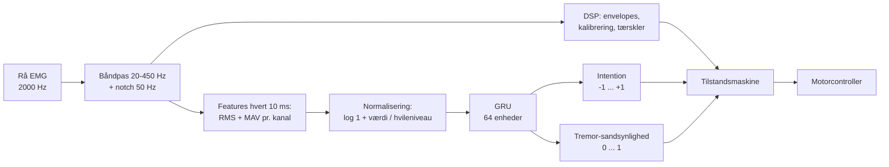

# GRU: et neuralt netværk som alternativ til signalbehandlingen

Systemet har to måder at omsætte EMG til "hvad vil brugeren, og er der tremor?":

| Metode | Hvordan | Vælges med |
|---|---|---|
| **DSP** (signalbehandling) | filtre, envelopes, kalibrering og faste tærskler | `--method dsp` (standard) |
| **GRU** (neuralt netværk) | et lille netværk, der har lært sammenhængen fra optagelser med facit | `--method gru` |

Begge metoder leverer til den **samme** tilstandsmaskine og den **samme** motorcontroller, så de kan sammenlignes direkte. DSP'en kører altid med og tager over, når GRU'en ikke er gyldig.

> **Status:** koden er færdig og testet som software. Der er **ikke** trænet en model på rigtige data endnu. Det kræver optagelser med facit (se [Sådan får I træningsdata](#sådan-får-i-træningsdata)). Modellen fra `--smoke-test` er trænet på opdigtede data og kan ikke bruges til noget.

## Overblik



Det samme som tekst:

```
rå EMG ─ båndpas + notch ─ filtreret EMG
   ├─ DSP: envelopes → kalibrering → grebsværdi + tremor ──────┐
   └─ GRU: RMS + MAV pr. kanal hvert 10 ms (seneste 50 ms)     │
           → log(1 + værdi / hvileniveau)                      ├→ tilstandsmaskine → motor
           → GRU (64 enheder, husker de seneste sekunder)      │
                → intention  −1 … +1                           │
                → tremor-sandsynlighed 0 … 1 ──────────────────┘
```

## Hvad er en GRU?

En GRU ("gated recurrent unit") læser ét sæt tal ad gangen, her ét sæt features hvert 10. millisekund. Den har en **hukommelse** (den "skjulte tilstand", 64 tal), som opsummerer, hvad der er sket indtil nu. Ved hvert skridt kombinerer den de nye features med hukommelsen og laver en ny hukommelse. Derfor kan den se rytme (tremor) og forløb (et greb, der bygges op), som ét enkelt øjebliksbillede ikke viser.

Oven på hukommelsen sidder to små "hoveder":

- **Intention:** ét tal mellem −1 og +1 (`tanh` holder det inden for intervallet).
- **Tremor:** ét tal mellem 0 og 1, en sandsynlighed (`sigmoid`).

Netværket har ca. 13.000 vægte, og ét skridt tager ca. 0,03 ms på en almindelig CPU. Der er altså rigelig tid inden for de 10 ms.

## Hvad betyder de to output?

**Intention** (−1 … +1) er den lukkegrad, brugeren er blevet bedt om eller har vist:

| Værdi | Betydning |
|---|---|
| +1 | luk: grib om objektet (normalt greb eller hårdt klem) |
| 0 | hvil (åben, afslappet hånd) |
| mellem 0 og 1 | delvist lukket; kræver facit fra fx en kraftmåler |
| −1 | åbn aktivt (stræk fingrene); kræver strækker-sensor og er ikke med i protokollerne |

Intentionen trænes mod et facit, der **ikke** kommer fra EMG'en selv: en cue-protokol eller målt bevægelse. Positionscontrolleren bruger kun lukke-delen, `max(intention, 0)`.

**Tremor-sandsynlighed** (0 … 1): over `GRU_TREMOR_ON` (0,6) tæller som tremor, under `GRU_TREMOR_OFF` (0,4) er tremoren væk. Holdetiderne er de samme som for DSP'en.

## 1 eller 2 EMG-sensorer

Modellen bygges til de sensorer, der står i `GRU_CHANNEL_ROLES` i `settings.py`:

- `["flexor"]`: én sensor på undersiden af armen (FDS). **Standard.**
- `["flexor", "extensor"]`: to sensorer, under- og overside (FDS + EDC).

Kanaler vælges efter **rolle**, ikke efter navn. En model gemmer selv, hvilke roller den er trænet med, og afviser at køre med en anden opsætning.

Vurdering på bænkoptagelsen fra 5. november 2026:

| | FDS (underside) | EDC (overside) |
|---|---|---|
| Hvile | 2,4 µV | 4,2 µV |
| Under greb | 62 µV (26× hvile) | 10 µV (2,4× hvile) |

- DSP'en virkede bedst med 1 sensor, fordi kalibreringen kræver mindst 3× hvile på alle kanaler, og EDC ligger lige omkring grænsen.
- EDC siger næsten intet nyt om selve grebet (dens envelope følger FDS, korrelation 0,80), og den varierer meget fra dag til dag.
- 2 sensorer kan to ting, 1 sensor ikke kan: se **aktiv åbning** (strækkemusklen) og se, at bøjer og strækker skiftes ved Parkinson-tremor.
- Med kun en bøjer-sensor kan åbning ikke skelnes fra hvile. Derfor trænes "åbn" (−1) som "intet greb" (0) i en 1-sensor-model.

Om 2 sensorer faktisk er bedre, kan kun afgøres ved at træne begge varianter på de samme optagelser og sammenligne dem med `evaluate_gru.py`.

## Filerne

| Fil | Indhold | PyTorch? |
|---|---|---|
| `settings.py` | GRU-indstillingerne (afsnittet "GRU") | nej |
| `source/gru/config.py` | `GRUConfig`: det, en model er bygget og trænet med | nej |
| `source/gru/features.py` | RMS + MAV hvert 10 ms, normalisering | nej |
| `source/gru/inference.py` | `GRUEstimator`: realtids-interfacet med hukommelse og gyldighed | nej |
| `source/gru/model.py` | selve netværket, gem/indlæs modelfil | **ja** |
| `source/gru/labels.py` | optagelser med facit: sessionsmapper og `.npz`-datasæt | nej |
| `source/gru/synthetic.py` | syntetisk tremor og opdigtede testdata | nej |
| `source/gru/training.py` | træningseksempler, opdeling, tab, træningsløkke | **ja** |
| `source/gru/evaluation.py` | GRU og DSP målt på de samme optagelser | nej |
| `source/cues.py` | cue-protokol, der giver facit for intentionen | nej |
| `train_gru.py`, `evaluate_gru.py` | scripts til træning og test | **ja** |

PyTorch installeres med `pip install -r requirements-ml.txt`. Uden PyTorch virker DSP-metoden som før, og `--method gru` falder tilbage til DSP med en besked.

## Sådan ændrer I indstillingerne

Alt står i afsnittet "GRU" i `settings.py`. De vigtigste kan også gives til `train_gru.py`:

| Hvad | I `settings.py` | Til `train_gru.py` |
|---|---|---|
| Antal sensorer | `GRU_CHANNEL_ROLES` | `--roles flexor` eller `--roles flexor extensor` |
| Antal GRU-enheder | `GRU_HIDDEN_UNITS` (64) | `--hidden-units 32` |
| Learning rate | `GRU_LEARNING_RATE` (0,001) | `--learning-rate 0.003` |
| Sekvenslængde | `GRU_SEQUENCE_SECONDS` (4 s) | `--sequence-seconds 6` |
| Antal epoker | `GRU_EPOCHS` (30) | `--epochs 50` |
| Feature-rate og -vindue | `GRU_FEATURE_RATE_HZ` (100), `GRU_FEATURE_WINDOW_S` (0,05) | – |
| Tremor-tærskler | `GRU_TREMOR_ON` / `GRU_TREMOR_OFF` | – |

En trænet modelfil husker sine egne værdier. Ændringer i `settings.py` gælder derfor for den **næste** model, I træner.

## Sådan får I træningsdata

Netværket lærer kun af optagelser, hvor facit er kendt for hvert øjeblik. Facit står i en `labels.csv` ved siden af `emg.csv`:

```
start_s,end_s,intention,tremor
10,14,0,0
14,18,1,0
30,34,-1,0
```

Et tomt felt betyder "ved vi ikke". Det er helt i orden: de øjeblikke tæller bare ikke med for det output.

**1. Egne optagelser med cue-protokol (intention).** Skærmen fortæller forsøgspersonen, hvad der skal gøres, og protokollen gemmes som facit:

```bat
.venv\Scripts\python.exe run_emg.py --source trigno --out measurements --label cue1 --cues protocols\greb_1.csv
```

Der er tre protokoller, `protocols/greb_1.csv`, `greb_2.csv` og `greb_3.csv`, på 64–66 sekunder hver. De indeholder de samme tre ting i forskellig rækkefølge og med forskellig varighed (3–6 s):

| Cue | Hvad personen gør | Facit |
|---|---|---|
| HVIL | slipper objektet og slapper af (åben, afslappet hånd) | 0 |
| GRIB | griber objektet med normalt greb, kun den nødvendige kraft | 1 |
| KLEM HÅRDT | klemmer hårdt om det samme objekt | 1 |

- Begge greb har facit 1, fordi exoskelettet styrer position: i begge tilfælde skal fingeren være lukket om objektet. Netværket lærer dermed, at et greb er et greb, uanset hvor hårdt der klemmes.
- De første 10 sekunder er kalibreringen (hvil, derefter normalt greb). De har intet facit.
- Skift mellem de tre protokoller. Hvis alle optagelser følger samme tidsplan, kan netværket lære tidsplanen i stedet for EMG'en.
- Brug det samme objekt hver gang. Sæt gerne sensorerne på igen mellem optagelserne.
- De første 0,5 s efter hvert skift regnes som ukendt, fordi en person skal bruge lidt tid på at reagere.
- Aktiv åbning (−1) og halvt greb (0,5) er ikke med. Motoren kan kun lukke fingeren, og et "halvt" greb kan ikke udføres ens uden en kraftmåler. Lav jeres egne protokoller ved at kopiere en af filerne.

**2. Syntetisk tremor (tremor).** `--add-synthetic-tremor` lægger kunstig 4–7 Hz-tremor oven på tremorfri optagelser, så facit er kendt præcist. Det er et hjælpemiddel til træning, ikke rigtig tremor.

**3. Offentlige datasæt.** Et datasæt konverteres til én `.npz`-fil pr. optagelse med nøglerne `emg` (kanaler × samples, i mV), `sample_rate`, `roles` og eventuelt `intention`, `tremor`, `group` og `rest_level`. Filen indlæses med `--npz` og omsamples automatisk til 2000 Hz. Konverteringsscripts til Pinheiro (rigtig Parkinson-tremor) og Ninapro (EMG + datahandske) er ikke skrevet endnu: de skal laves ud fra de rigtige filer.

## Træning

```bat
.venv\Scripts\python.exe train_gru.py --sessions measurements\<mappe1> measurements\<mappe2> measurements\<mappe3> --add-synthetic-tremor
```

Det sker der:

1. Optagelserne indlæses, filtreres med det samme filter som live og laves til features hvert 10 ms.
2. **Hele** optagelser (eller personer) sættes til side: ca. 60 % til træning, 20 % til validering og 20 % til test. Der skal derfor være mindst 3 uafhængige optagelser.
3. Træningsoptagelserne klippes i stykker på 4 sekunder. Netværket ser alle stykker én gang pr. epoke, og efter hvert hold justeres vægtene lidt, så outputtet kommer tættere på facit.
4. Efter hver epoke måles fejlen på valideringsoptagelserne. Vægtene med den laveste valideringsfejl beholdes.
5. Til sidst testes modellen på testoptagelserne, og den gemmes i `models/gru.pt` med resultaterne i `models/gru.json`.

To ting holder resultatet ærligt:

- **Ingen lækage:** stykker fra samme optagelse havner aldrig på begge sider af opdelingen. Nabostykker ligner hinanden så meget, at testen ellers ville blive alt for nem. En kopi med syntetisk tremor følger altid sin original.
- **Maskering:** ukendt facit indgår ikke i fejlen. Netværket trænes aldrig mod et opdigtet svar.

## Test af en model

```bat
.venv\Scripts\python.exe evaluate_gru.py --model models\gru.pt --sessions measurements\<ny mappe>
```

Scriptet kører GRU og DSP på de samme optagelser og måler dem mod det samme facit, hvert 10. ms:

| Tal | Betydning |
|---|---|
| `mae` | gennemsnitlig afstand mellem output og facit (0 er perfekt) |
| `rmse` | som `mae`, men store fejl tæller mere |
| `correlation` | følger outputtet facit op og ned? (1 er perfekt) |
| `precision` | af det, der blev kaldt tremor: hvor stor en del var tremor |
| `recall` | af den rigtige tremor: hvor stor en del blev fundet |
| `false_alarms_per_minute` | falske tremor-alarmer pr. minut uden tremor |
| `median_latency_s` | tid fra tremoren starter, til den opdages |

Optagelser, der blev brugt til træning, springes over. Husk tre forbehold:

- Test på **syntetisk** tremor siger ikke noget om rigtig tremor. DSP'en er bygget til netop det mønster, og GRU'en er trænet på det.
- "Ikke set før" bør betyde en anden **person**, ikke bare en anden optagelse af den samme.
- Tallene måler signalet. Hvordan fingeren faktisk opfører sig, ses kun på bænken.

## Realtid

```bat
.venv\Scripts\python.exe run_emg.py --source trigno --calibration measurements\plac_calibration.json --method gru --model models\gru.pt
```

For hver EMG-blok sker dette i `Pipeline.step` (`source/pipeline.py`):

1. Blokken filtreres, og DSP'en regner sin grebsværdi og sine tremormål som altid.
2. `GRUEstimator.update(...)` laver features af den filtrerede EMG, kører netværket videre fra sin hukommelse og giver et `GRUEstimate`:

   ```python
   estimate.intention            # -1 ... +1
   estimate.tremor_probability   # 0 ... 1
   estimate.valid                # False: tallene må ikke bruges
   estimate.reason               # hvorfor ikke
   ```

3. Er estimatet gyldigt, får tilstandsmaskinen GRU'ens tal. Ellers får den DSP'ens.

Det nyeste estimat ligger i `pipeline.gru_estimate`, og `pipeline.dsp_activation` holder DSP'ens tal, så begge kan aflæses samtidig. Vinduet viser metoden og GRU'ens to output som stiplede kurver.

**GRU'en styrer aldrig motoren.** Den leverer kun tal. Tilstandsmaskinen, `source/motor.py` og Emils controller bestemmer, hvad motoren gør, præcis som med DSP'en.

Sikkerhedsreglerne i koblingen:

| Situation | Hvad sker der |
|---|---|
| Ingen modelfil, eller PyTorch mangler | DSP bruges, med en besked |
| Modellen passer ikke (sensorer, 2000 Hz, filterindstillinger) | DSP bruges, med årsagen |
| Lige efter start eller afbrydelse | GRU'en "varmer op" i 1 s; DSP bruges imens |
| EMG'en udebliver (timeout) | GRU'ens hukommelse tømmes, og den varmer op igen |
| Netværket giver et ugyldigt tal (NaN) | GRU'en slås fra, indtil der kalibreres igen |
| GRU'en bliver gyldig midt i et greb | DSP beholder styringen, til fingeren er åben igen (ingen spring i motoren) |
| Model trænet på opdigtede data + `--motor` | modellen afvises; DSP bruges |
| Kalibrering og armering | sker altid på DSP'ens tal |

Normaliseringen bruger hvileniveauet fra den almindelige kalibrering. GRU-metoden kræver derfor også en kalibrering, og den kræver 2000 Hz fra Trigno.

## Softwaretest uden rigtige data

```bat
.venv\Scripts\python.exe train_gru.py --smoke-test --out models\smoke.pt
.venv\Scripts\python.exe evaluate_gru.py --model models\smoke.pt --smoke-test
```

Det træner og tester på **opdigtede** data (støj, hvor amplituden følger facit) og viser kun, at koden hænger sammen fra ende til anden. Modellen mærkes `synthetic` og kan ikke bruges med `--motor`.

Enhedstests (køres med `test.bat` / `./test.sh`):

| Testfil | Dækker |
|---|---|
| `tests/test_gru_features.py` | features: form, blokstørrelser, normalisering |
| `tests/test_gru_inference.py` | hukommelse, opvarmning, gyldighed, forkert opsætning |
| `tests/test_gru_model.py` | output-former og -intervaller, streaming = hel sekvens, modelfil |
| `tests/test_gru_labels.py` | `labels.csv`, hvileniveau, `.npz`, syntetisk tremor |
| `tests/test_gru_training.py` | træningseksempler, opdeling uden lækage, maskering |
| `tests/test_gru_evaluation.py` | metrikker, GRU mod DSP |
| `tests/test_gru_scripts.py` | træning, test og `run_emg.py --method gru` fra ende til anden |
| `tests/test_pipeline.py` | koblingen: fallback, armering på DSP, skift kun med åben finger |

Tests, der kræver PyTorch, springes over, hvis PyTorch ikke er installeret.

## Det mangler

1. **Rigtige data med facit.** Mindst 3 cue-optagelser, helst fra flere personer og flere dage.
2. **Rigtig tremor.** Pinheiro-datasættet (4 personer med Parkinson, 1 med essentiel tremor) skal hentes og konverteres. Det har kun tremor og ingen tremorfri perioder, så det kan vise, om tremor bliver fundet, men ikke hvor mange falske alarmer der kommer.
3. **Bænktest.** `--method gru` er kun kørt på afspilninger og med en falsk motor, ikke med Trigno og den rigtige motor.
4. **Hastighedscontroller.** Der findes kun positionscontrollere. En hastighedscontroller kan læse `estimate.intention` direkte som "luk/åbn med denne fart".
5. **Stivheden** sendes stadig ikke til motoren, heller ikke med GRU-metoden.
